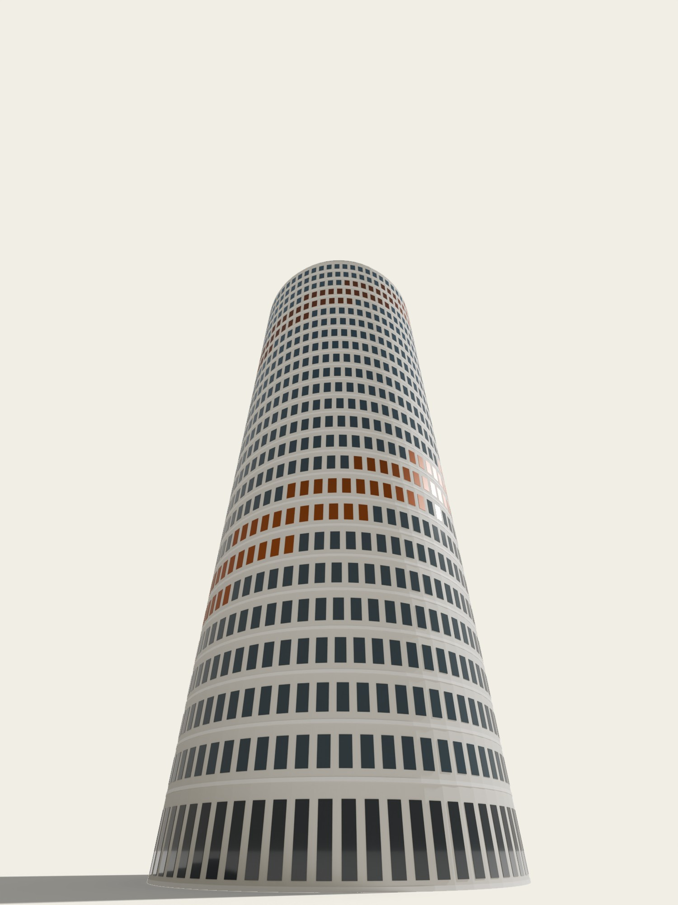

# Срез

Генератор массинга жилой башни с проверкой по ТЗ. Учебный проект курса ПИК × МФТИ, задание 4 «Вайб-моделирование башни».

[Открыть студию с чатом](https://srez-tower-studio.vercel.app/) · [GitHub Pages](https://alteralto.github.io/srez-tower-studio/) · [Альбом проекта, PDF](examples/tower-project.pdf) · [3D-модель, GLB](examples/tower.glb)



## Главное

ТЗ задания (25 этажей, квартиры 10 300–11 500 м², ГНС 16–18 тыс. м², застройка 450–650 м²) почти не оставляет места для скульптуры. Первый этаж общественный, поэтому средний жилой этаж должен быть не меньше ≈ 644 м², а площадь застройки — проекция всего объёма — ограничена 650 м². Запас меньше 1 %.

Перебор форм в инструменте это подтверждает: скручивание призмы на 15° добавляет ≈ 70 м² застройки, сужение, наклон и каскад тоже выводят её за предел. В коридоре остаётся тело вращения. Поэтому основной вариант — цилиндр Ø 28,7 м со скручиванием 120°: поворот читается по сдвигу оконной сетки и медной спирали простенков, а пятно остаётся кругом.

## Что умеет

- Параметры формы: этажность, габарит, срез углов, скругление, скручивание, спираль фасада, сужение, поворот, сдвиг вершины, каскадные и верхние уступы.
- Поэтажно считает ГНС, ОРП, площадь застройки (объединение проекций всех этажей), К0, квартиры и жителей.
- Проверяет шесть пунктов ТЗ и показывает величину отклонения.
- «Подогнать габарит под ТЗ» — находит наибольший габарит текущей формы, при котором застройка ≤ 650 м², или называет пункт ТЗ, который форма не выполняет.
- Три варианта для сравнения: цилиндр и призма в ТЗ, скульптура вне ТЗ.
- Чат меняет форму через JSON со строгой схемой; сервер проверяет каждое значение по сетке параметров, изменение можно отменить.
- Экспорт GLB, OBJ/MTL, PNG, CSV и JSON.

## Основной вариант

| Показатель | ТЗ | Модель |
|---|---:|---:|
| Этажи | 25 | 25 |
| Квартиры | 180–230 | 192 |
| Жители, сценарная оценка | 380–430 | 408 |
| Площадь квартир, ОРП | 10 300–11 500 м² | 10 339,90 м² |
| Площадь здания, ГНС | 16 000–18 000 м² | 16 147,15 м² |
| Площадь застройки | 450–650 м² | 646,76 м² |
| К0 = ОРП / ГНС | 0,58–0,60 (микробриф) | 0,6404 |
| Высота с завершением | — | 81,76 м |

ОРП этажа — эскизная оценка микробрифа: `(ГНС этажа − ЛЛУ − МКК) × 0,84`. При 25 этажах и застройке до 650 м² ГНС не больше 16 250 м², поэтому требуемые 10 300 м² квартир дают К0 не ниже 0,634: ориентир 0,58–0,60 несовместим с остальными пунктами ТЗ. Отклонение раскрыто в альбоме, а не подогнано.

Планы — схема зон вокруг ядра. Комнаты, каталог ЛЛУ, пожарные решения и инсоляция требуют исходных данных участка. Км1 и Км2 не рассчитаны: методика и пресет заказчика не предоставлены.

## Комплект для сдачи

- `public/index.html` после `npm run build` — инструмент одним HTML-файлом, открывается двойным щелчком.
- `examples/tower.glb` (метры, ось Y вверх), `examples/tower.obj` + `tower.mtl` (метры, ось Z вверх).
- `examples/tower-project.pdf` — альбом на 11 листов A3. Собирается из движка, поэтому числа в нём совпадают с инструментом.
- `examples/renders/` — рендеры Blender 5.1 Cycles по экспорту GLB.

## Локальный запуск с чатом

Нужен Node.js 20.19 или новее. Сторонних пакетов нет.

```powershell
$env:TOWER_API_KEY_FILE = 'C:\path\to\api-key.txt'
npm start
```

Откройте [127.0.0.1:8765](http://127.0.0.1:8765). Вместо файла можно передать ключ через `TOWER_API_KEY`. Модель по умолчанию `gpt-4.1-mini`, меняется через `TOWER_MODEL`, порт — через `PORT`.

Сервер слушает только loopback, проверяет Origin, тип и размер запроса и сетку параметров. В API уходят запрос, последние сообщения разговора и параметры башни; `store: false`. История хранится только в памяти вкладки.

## Чат на Vercel

Проект импортируется в Vercel без фреймворка, настройки сборки в `vercel.json`. Ключ — серверная переменная `TOWER_API_KEY`, в HTML и git его нет. Для GitHub Pages адрес функции задаётся в `site-config.json`, затем `node scripts/publish-site.cjs`. Дополнительные origins — переменная `TOWER_ALLOWED_ORIGINS`.

## Разработка

```powershell
npm test
npm run build
node scripts/export-examples.cjs   # GLB, OBJ, CSV, JSON основного варианта и GLB для сравнения
node scripts/album.cjs             # examples/album.html → печать в PDF A3
node scripts/publish-site.cjs      # docs/ для GitHub Pages
```

`src/engine.js` и `src/forms.js` — геометрия, площади, объединение проекций и экспорт. `src/app.js` — интерфейс, проверка ТЗ и подбор габарита. `src/chat.js` — чат, применение JSON и отмена. `server.cjs` — локальный API. Интеграция чата следует [документации Responses API и Structured Outputs](https://developers.openai.com/api/docs/guides/structured-outputs).

Материалы задания и микробриф в репозиторий не включены.

Алексей Ткаченко, 2026.
