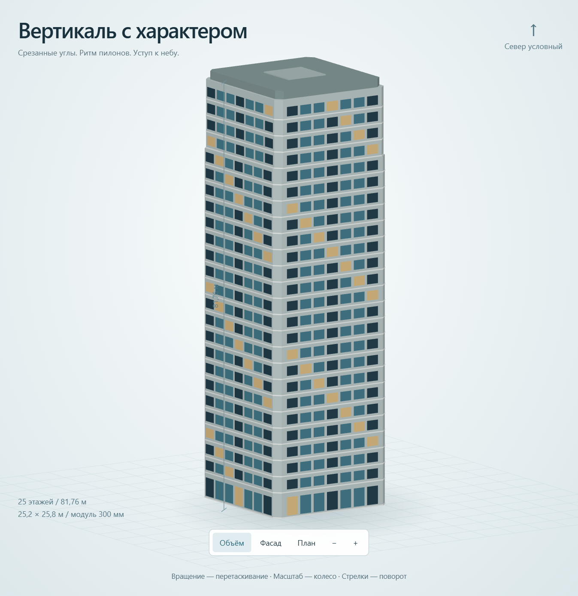

# Срез

Параметрический инструмент для генерации массинга жилой башни. Учебный проект ПИК × МФТИ, задание 3.

[Открыть инструмент](https://alteralto.github.io/srez-tower-studio/) · [Проект в PDF](examples/tower-project.pdf) · [3D-модель](examples/tower.glb)



## Что умеет

- Меняет этажность, габариты, срез углов, типовую высоту и верхний уступ.
- Показывает объём, фасад и компоновочную схему этажа.
- Пересчитывает ГНС, ОРП, К0, число квартир и оценку жителей.
- Сохраняет GLB, OBJ/MTL, PNG, CSV и параметры JSON.
- Чат объясняет показатели и меняет модель через JSON. Изменения применяются автоматически, доступны отмена и скачивание JSON ответа.

GitHub Pages позволяет крутить модель и пользоваться расчётами без установки. Для чата подготовлены Vercel Functions: отдельная ВМ не нужна, ключ в статический сайт не включается.

## Чат на Vercel без ВМ

Импортируйте этот репозиторий в Vercel как проект без фреймворка. Настройки сборки заданы в `vercel.json`.

Добавьте серверную переменную `TOWER_API_KEY` со значением своего API-ключа и выполните Deploy. `TOWER_MODEL` по умолчанию равен `gpt-4.1-mini`. Ключ не должен находиться в `site-config.json`, HTML или git.

После публикации впишите адрес проекта в `site-config.json`, например `{"chatApiBase":"https://your-project.vercel.app"}`, запустите `node scripts/publish-site.cjs` и отправьте изменения в GitHub. Pages начнёт использовать `/api/status` и `/api/chat` указанного проекта. ВМ и постоянно запущенный локальный сервер для этого не нужны.

Функция принимает браузерные запросы с `https://alteralto.github.io`; дополнительные origins задаются серверной переменной `TOWER_ALLOWED_ORIGINS` через запятую. Есть ограничения размера сообщения, времени ответа и частоты запросов в пределах экземпляра функции. Для устойчивого общего лимита публичного сервиса требуется ограничение на уровне хостинга.

## Локальный запуск с чатом

Нужен Node.js 20.19 или новее. Сторонних пакетов нет.

```powershell
$env:TOWER_API_KEY_FILE = 'C:\path\to\api-key.txt'
npm start
```

Откройте [127.0.0.1:8765](http://127.0.0.1:8765). Вместо файла можно передать ключ через переменную `TOWER_API_KEY`. По умолчанию используется `gpt-4.1-mini`; модель меняется через `TOWER_MODEL`, порт — через `PORT`. Файлы `.env` автоматически не загружаются.

Сервер слушает только loopback-интерфейс, проверяет Origin, тип и размер запроса и допустимую сетку параметров. В API уходят запрос, последние сообщения этого разговора и параметры башни. История хранится только в памяти вкладки. В запросе к API задано `store: false`.

Без чата можно собрать автономный HTML и открыть его двойным щелчком:

```powershell
npm run build
# public/index.html
```

## Исходный вариант

| Показатель | Значение |
|---|---:|
| Надземные этажи | 25 |
| Квартиры | 192 |
| Жители, сценарная оценка | 408 |
| Футпринт | 647,28 м² |
| ГНС | 16 120,08 м² |
| ОРП квартир | 10 315,99 м² |
| К0 = ОРП / ГНС | 0,639946 |
| Высота с завершением | 81,76 м |

ГНС считается по наружному контуру каждого надземного этажа. ОРП — предварительная оценка `(ГНС жилого этажа − ЛЛУ − МКК) × 0,84`. Первый этаж общественный. Подземных этажей, балконов и террас в варианте нет.

При 25 этажах и футпринте до 650 м² ГНС не может превышать 16 250 м². Поэтому требуемые минимум 10 300 м² квартир дают К0 не ниже 0,633846. Ориентир микробрифа 0,58–0,60 несовместим с этими условиями. В варианте сохранены параметры задания; отклонение раскрыто в PDF.

Планы показывают схему компоновки. Комнаты, каталог ЛЛУ, пожарные решения и инсоляция требуют дальнейшей разработки по исходным данным участка. Км1 и Км2 не рассчитаны: расчётная методика и пресет заказчика не предоставлены.

## Разработка

```powershell
npm test
npm run build
node scripts/publish-site.cjs
```

`src/engine.js` — геометрия, площади и экспорт. `src/app.js` — управление моделью. `src/chat.js` — чат, применение JSON и отмена изменений. `server.cjs` — локальный API. `docs/` — сборка GitHub Pages; `examples/` — исходный комплект для сдачи.

GLB использует метры и ось Y вверх. OBJ использует метры и ось Z вверх; файл MTL нужно держать рядом.

Интеграция чата следует [документации Responses API и Structured Outputs](https://developers.openai.com/api/docs/guides/structured-outputs). Материалы задания и микробриф в репозиторий не включены.

Алексей Ткаченко, 2026.
